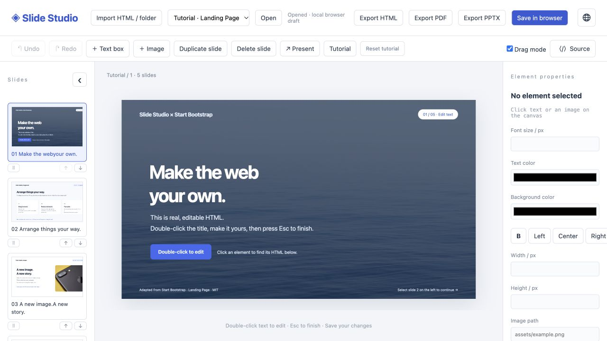
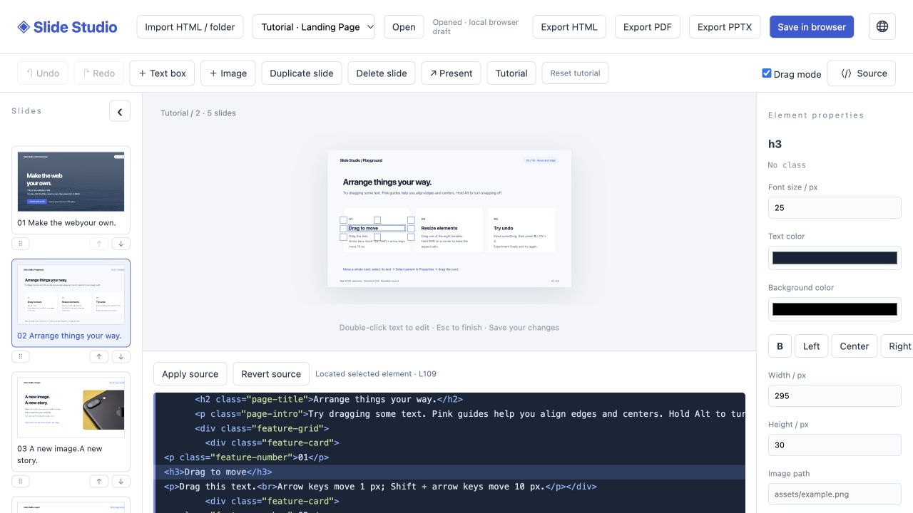
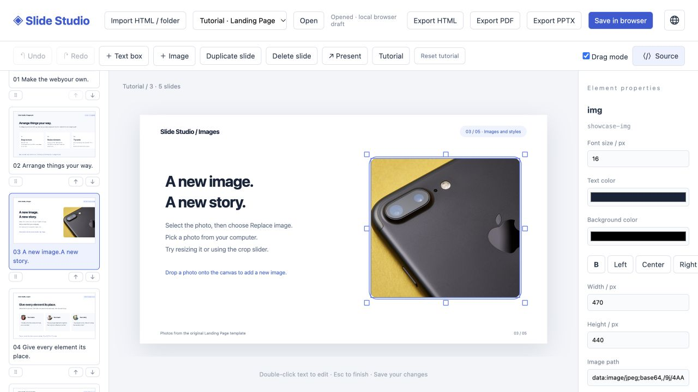

<div align="center">


# Slide Studio

### Edit like slides. Keep the HTML.

A visual workspace for HTML presentations.<br>
Edit text, arrange elements, and work with readable source — in your browser or on your Mac.

**[Try it online →](https://html-slide-editor-sepia.vercel.app/)** &nbsp; · &nbsp; [Get started](#get-started) &nbsp; · &nbsp; [User guide](docs/guide.md) &nbsp; · &nbsp; [简体中文](README.zh-CN.md)

`Web + macOS` &nbsp; `Plain HTML` &nbsp; `English · 日本語 · 中文`

</div>

[](https://html-slide-editor-sepia.vercel.app/)

<p align="center"><sub>Real interface. Real HTML. Start with the built-in, five-slide playground.</sub></p>

## From an idea to a slide you can actually adjust

Let AI draft the HTML, or start with your own deck. Then make the small changes yourself: fix a headline, move an image, align a card, or reorder a page. Your work stays in ordinary HTML, ready for the next manual or AI-assisted edit.

| Make it yours | Keep control |
| --- | --- |
| **Edit on the canvas** — double-click text, type, and press Esc. | **Stay close to the code** — select an element to find and highlight its HTML. |
| **Arrange visually** — drag, resize, snap to guides, or group elements. | **Review before saving** — inspect a side-by-side HTML diff. |
| **Build the story** — reorder thumbnails, add pages, replace images. | **Take your work with you** — export HTML, PDF, or PowerPoint `.pptx`. |

## Click the slide. Find the source.

Visual editing and source editing share the same document. Selecting a text box scrolls the source to the corresponding element, even when the same text appears elsewhere. Edit the HTML directly and apply it back to the canvas.



## A workspace that fits the way you work

<table>
<tr>
<td width="50%" valign="top">

### Images, without the guesswork

Select a photo to resize, replace, or crop it. Add your own images with a button or drag them onto the canvas.

[](docs/images/image-tools.jpg)

</td>
<td width="50%" valign="top">

### More space. Your language.

Collapse the preview rail when you want to focus. Switch between English, Japanese, and Chinese; the tutorial follows along.

[](docs/images/japanese-focus.jpg)

</td>
</tr>
</table>

## Get started

### Open it. Try it. Make it yours.

1. **[Launch the online editor](https://html-slide-editor-sepia.vercel.app/).** No installation or account is required.
2. **Explore the five-slide tutorial.** Practice text editing, layout, images, grouping, and export. Switch languages without losing custom text or layout edits.
3. **Import your deck.** Choose a self-contained HTML file, or its complete folder when images and CSS are separate. Save a browser draft or export HTML to keep a backup.

### Choose your workspace

| | Online editor | Mac app | Local browser |
| --- | --- | --- | --- |
| **Start** | [Open the editor](https://html-slide-editor-sepia.vercel.app/) | [Build the Mac app](desktop/macos/README.md) | Run the Python server below |
| **Open files** | Import HTML or a folder | Native file / folder picker | Deck folders inside the project |
| **Save** | Draft in this browser; download HTML | Save your own files with backups | Save your own files with backups |
| **Best for** | Trying it out, working across platforms | Editing local decks on macOS | Working alongside your code editor |

<details>
<summary><strong>Run in a local browser</strong> · Python 3.9+, no packages to install</summary>

```sh
git clone https://github.com/donaldhxp0127/HTML-Slide-Editor.git
cd HTML-Slide-Editor
python3 slide-editor/server.py
```

Open [127.0.0.1:8765](http://127.0.0.1:8765/) and keep the terminal running. On macOS, you can also double-click `slide-editor/启动编辑器.command`.

Put your decks in a folder alongside `slide-editor/`, keeping their CSS, JavaScript, and images together. Refresh the editor, choose a deck, and click **Open**.

</details>

<details>
<summary><strong>Build the Mac app</strong> · macOS with Xcode Command Line Tools</summary>

```sh
./desktop/macos/build.sh
```

Open `dist/Slide Studio.app`. The packaged app needs no Python, Node.js, or terminal. Builds target the host architecture; Apple Silicon has been tested. Local builds are ad-hoc signed and not notarized for public distribution. [Mac setup and build notes →](desktop/macos/README.md)

</details>

## Your HTML stays yours

- **Ordinary files.** Keep HTML tags and classes; visual style overrides use standard inline CSS. There is no proprietary slide format. Browser serialization may normalize formatting.
- **Files stay local to your editor.** The hosted version processes imports in your browser; its draft storage belongs to that browser and device. The desktop and local-server versions edit local files. Decks may still load remote resources they reference.
- **A clear export path.** HTML stays editable. PDF and PPTX preserve appearance as high-resolution page images; their text is not individually editable. Continue making changes in the HTML.

### Bring an HTML slide deck

Slide Studio currently works with **static HTML slides using `.slide` containers on a 1280 × 720 canvas**. It does not automatically turn arbitrary websites into slides. Original deck scripts are paused during editing, so dynamically generated content and interactive charts need a static equivalent.

Browser drafts can be cleared or evicted: export HTML for durable backups. Remote assets need connectivity, and image export may require CORS support. See the [full guide](docs/guide.md#current-limitations) for limits and file-handling details.

## Explore further

| | |
| --- | --- |
| [User guide](docs/guide.md) | Editing tools, keyboard shortcuts, source workflow, and storage details |
| [中文使用指南](docs/guide.zh-CN.md) | 操作说明、文件保存与部署方式 |
| [Deploy your own copy](docs/guide.md#deploy-on-vercel) | Static Vercel deployment; no database or server functions |
| [Tutorial source](examples/landing-page/) | Edit the sample deck and regenerate its offline version |
| [Report an issue](https://github.com/donaldhxp0127/HTML-Slide-Editor/issues) | Share a reproducible issue or suggest an improvement |

---

<sub>Interface screenshots use the included tutorial, adapted from [Start Bootstrap Landing Page](https://github.com/StartBootstrap/startbootstrap-landing-page). Its [MIT notice](examples/landing-page/LICENSE) is retained. Export dependencies and their licenses are listed in [vendor notices](slide-editor/vendor/README.md).</sub>

<div align="center">

**Make the visual change. Keep the source.**<br>
[Open Slide Studio →](https://html-slide-editor-sepia.vercel.app/)

</div>
